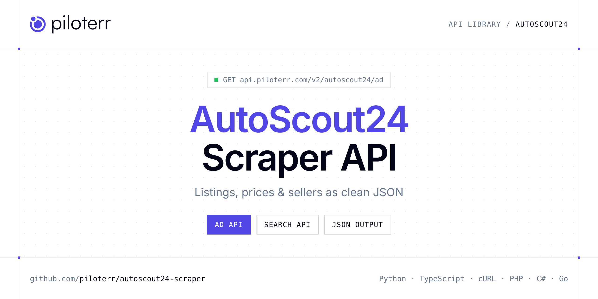

<p align="center">
  <a href="https://www.piloterr.com"></a>
</p>

# AutoScout24 Scraper API

[](https://discord.gg/CFj3ph8aHU) [](https://app.piloterr.com) [](https://app.piloterr.com/openapi) [](LICENSE)

The **Piloterr AutoScout24 Scraper API** lets you extract public data from AutoScout24 as **clean, structured JSON** — no proxies, headless browsers or HTML parsing to maintain. Endpoints available in production:

- **AutoScout24 Ad API** — Read one AutoScout24 listing, including an inactive ad that still exposes the listing.
- **AutoScout24 Search API** — Search AutoScout24 listings from a search URL.

Use it for listing monitoring, price benchmarks, stock sourcing or market analytics on second-hand and vehicle marketplaces.

| Endpoint | Path | Credits | What you get |
|---|---|---|---|
| [AutoScout24 Ad API](#autoscout24-ad-api) | `/v2/autoscout24/ad` | 1 | Read one AutoScout24 listing, including an inactive ad that still exposes the listing. Price, vehicle, seller, and location. (1 credit) |
| [AutoScout24 Search API](#autoscout24-search-api) | `/v2/autoscout24/search` | 1 | Search AutoScout24 listings from a search URL. Each card has make, model, numeric price, mileage, and the listing URL. (1 credit) |

## Table of contents

- [How it works](#how-it-works)
- [AutoScout24 Ad API](#autoscout24-ad-api)
- [AutoScout24 Search API](#autoscout24-search-api)
- [Code examples in other languages](#code-examples-in-other-languages)
- [Practical use cases](#practical-use-cases)
- [Why Piloterr?](#why-piloterr)
- [FAQ](#faq)
- [Related scrapers](#related-scrapers)
- [Support](#support)

## How it works

1. **Create a free Piloterr account** and copy your API key from the [dashboard](https://app.piloterr.com).
2. **Send a `GET` (or `POST`) request** to `https://api.piloterr.com/v2/...` with the header `x-api-key: YOUR_API_KEY`.
3. **Receive structured JSON** — Piloterr handles rendering, proxies, retries and parsing.

```bash
export PILOTERR_API_KEY="your-api-key"
pip install requests        # Python
# TypeScript: Node.js 18+ (native fetch), run with `npx tsx file.ts`
```

> Every endpoint accepts both `GET` (query string) and `POST` (JSON body with the same fields).

## AutoScout24 Ad API

Read one AutoScout24 listing, including an inactive ad that still exposes the listing. Price, vehicle, seller, and location. (1 credit)

`GET | POST https://api.piloterr.com/v2/autoscout24/ad` · **1 credit per request** · [Full reference](https://app.piloterr.com/openapi)

### Request parameters

| Parameter | Type | Required | Description |
|---|---|---|---|
| `query` | string | ✅ | Full AutoScout24 listing URL. An inactive listing that still contains script#__NEXT_DATA__ is returned with status Inactive. A page without that selector returns 404. |

### Python example

```python
import json
import os
import requests

response = requests.get(
    "https://api.piloterr.com/v2/autoscout24/ad",
    headers={"x-api-key": os.environ["PILOTERR_API_KEY"]},
    params={
        "query": "https://www.autoscout24.fr/offres/porsche-macan-s-diesel-pano-1-hand-diesel-or-cat_ma57mo20311-547632b2-e4fc-47f3-8143-1a2d7b276366",
    },
    timeout=60,
)
response.raise_for_status()
data = response.json()

print(json.dumps(data, indent=2, ensure_ascii=False)[:2000])
```

### TypeScript example

```typescript
type Autoscout24Ad = {
  id?: string;
  image?: string;
  price?: {
    price_formatted?: string;
    is_conditional_price?: boolean;
    is_vat_label_legally_required?: boolean;
  };
  title?: string;
  images?: string[];
  prices?: {
    dealer?: {
      price?: string;
      price_raw?: number;
      negotiable?: boolean;
      tax_deductible?: boolean;
      on_request_only?: boolean;
    };
    public?: {
      price?: string;
      price_raw?: number;
      negotiable?: boolean;
      tax_deductible?: boolean;
      on_request_only?: boolean;
    };
  };
  seller?: {
    id?: number;
    type?: string;
    phones?: {
      call_to?: string;
      phone_type?: string;
      formatted_number?: string;
    }[];
    is_dealer?: boolean;
    company_name?: string;
  };
  status?: string;
  vehicle?: {
    make?: string;
    model?: string;
    body_type?: string;
    body_color?: string;
    power_in_kw?: string;
    primary_fuel?: {
      raw?: number;
      formatted?: string;
    };
    mileage_in_km?: string;
    number_of_doors?: number;
    number_of_seats?: number;
    mileage_in_km_raw?: number;
    transmission_type?: string;
    model_version_input?: string;
    first_registration_date?: string;
  };
  location?: {
    zip?: string;
    city?: string;
    street?: string;
    country_code?: string;
  };
  web_page?: string;
  description?: string;
};

const params = new URLSearchParams({
  "query": "https://www.autoscout24.fr/offres/porsche-macan-s-diesel-pano-1-hand-diesel-or-cat_ma57mo20311-547632b2-e4fc-47f3-8143-1a2d7b276366",
});

const response = await fetch(`https://api.piloterr.com/v2/autoscout24/ad?${params}`, {
  headers: { "x-api-key": process.env.PILOTERR_API_KEY! },
});
if (!response.ok) throw new Error(`Piloterr error ${response.status}: ${await response.text()}`);

const data = (await response.json()) as Autoscout24Ad;

console.log(JSON.stringify(data, null, 2).slice(0, 2000));
```

<details>
<summary><b>POST variant</b></summary>

```http
POST https://api.piloterr.com/v2/autoscout24/ad
x-api-key: YOUR_API_KEY
Content-Type: application/json

{"query": "https://www.autoscout24.fr/offres/porsche-macan-s-diesel-pano-1-hand-diesel-or-cat_ma57mo20311-547632b2-e4fc-47f3-8143-1a2d7b276366"}
```
</details>

### Output example

Example response from the API reference, abridged — real values depend on the page you scrape.

```json
{
  "id": "547632b2-e4fc-47f3-8143-1a2d7b276366",
  "image": "https://prod.pictures.autoscout24.net/listing-images/547632b2-e4fc-47f3-8143-1a2d7b276366_e8e7d7f9-5101-4dad-9d0c-342384727f9d.jpg/1280x9…",
  "price": {
    "price_formatted": "€ 39 990",
    "is_conditional_price": false,
    "is_vat_label_legally_required": false
  },
  "title": "Porsche Macan",
  "images": [
    "https://prod.pictures.autoscout24.net/listing-images/547632b2-e4fc-47f3-8143-1a2d7b276366_e8e7d7f9-5101-4dad-9d0c-342384727f9d.jpg/1280x9…"
  ],
  "prices": {
    "dealer": {
      "price": "€ 39 990",
      "price_raw": 39990,
      "negotiable": false,
      "tax_deductible": false,
      "on_request_only": false
    },
    "public": {
      "price": "€ 39 990",
      "price_raw": 39990,
      "negotiable": false,
      "tax_deductible": false,
      "on_request_only": false
    }
  },
  "seller": {
    "id": 0,
    "type": "example",
    "phones": [
      {
        "call_to": "example",
        "phone_type": "example",
        "formatted_number": "example"
      }
    ],
    "is_dealer": true,
    "company_name": "example"
  },
  "status": "Inactive",
  "vehicle": {
    "make": "Porsche",
    "model": "Macan",
    "body_type": "SUV/4x4/Pick-Up",
    "body_color": "Or",
    "power_in_kw": "190 kW",
    "primary_fuel": {
      "raw": 7,
      "formatted": "Diesel"
    },
    "mileage_in_km": "24 585 km",
    "number_of_doors": 4,
    "number_of_seats": 5,
    "mileage_in_km_raw": 24585,
    "transmission_type": "Boîte automatique",
    "model_version_input": "S Diesel Pano 1.Hand",
    "first_registration_date": "04/2015"
  },
  "location": {
    "zip": "88074",
    "city": "Meckenbeuren",
    "street": "Hauptstrasse 67",
    "country_code": "DE"
  },
  "web_page": "https://www.autoscout24.fr/offres/porsche-macan-s-diesel-pano-1-hand-diesel-or-cat_ma57mo20311-547632b2-e4fc-47f3-8143-1a2d7b276366",
  "description": "<strong>Sonderausstattung:<br />Deutsches Fahrzeug, 1. Hand, PZ Scheckheft</strong>"
}
```

### Response fields

| Field | Type | Description |
|---|---|---|
| `id` | string |  |
| `image` | string |  |
| `price` | object |  |
| `price.price_formatted` | string |  |
| `price.is_conditional_price` | boolean |  |
| `price.is_vat_label_legally_required` | boolean |  |
| `title` | string |  |
| `images` | string[] |  |
| `prices` | object |  |
| `prices.dealer` | object |  |
| `prices.public` | object |  |
| `seller` | object |  |
| `seller.id` | integer |  |
| `seller.type` | string |  |
| `seller.phones[]` | object[] |  |
| `seller.is_dealer` | boolean |  |
| `seller.company_name` | string |  |
| `status` | string |  |
| `vehicle` | object |  |
| `vehicle.make` | string |  |
| `vehicle.model` | string |  |
| `vehicle.body_type` | string |  |
| `vehicle.body_color` | string |  |
| `vehicle.power_in_kw` | string |  |
| `vehicle.primary_fuel` | object |  |

## AutoScout24 Search API

Search AutoScout24 listings from a search URL. Each card has make, model, numeric price, mileage, and the listing URL. (1 credit)

`GET | POST https://api.piloterr.com/v2/autoscout24/search` · **1 credit per request** · [Full reference](https://app.piloterr.com/openapi)

### Request parameters

| Parameter | Type | Required | Description |
|---|---|---|---|
| `query` | string | ✅ | Full AutoScout24 search URL. Filters and page in the URL are kept. page starts at 1. A page with no cards returns 404. |

### Python example

```python
import json
import os
import requests

response = requests.get(
    "https://api.piloterr.com/v2/autoscout24/search",
    headers={"x-api-key": os.environ["PILOTERR_API_KEY"]},
    params={
        "query": "https://www.autoscout24.fr/lst/volkswagen/golf?atype=C",
    },
    timeout=60,
)
response.raise_for_status()
data = response.json()

print(json.dumps(data, indent=2, ensure_ascii=False)[:2000])
```

### TypeScript example

```typescript
type Autoscout24Search = {
  results?: {
    id?: string;
    url?: string;
    make?: string;
    year?: string;
    image?: string;
    model?: string;
    price?: number;
    title?: string;
    mileage?: string;
    first_registration?: string;
  }[];
  pagination?: {
    next?: string;
    page?: number;
    per_page?: number;
    total_pages?: number;
    total_results?: number;
  };
};

const params = new URLSearchParams({
  "query": "https://www.autoscout24.fr/lst/volkswagen/golf?atype=C",
});

const response = await fetch(`https://api.piloterr.com/v2/autoscout24/search?${params}`, {
  headers: { "x-api-key": process.env.PILOTERR_API_KEY! },
});
if (!response.ok) throw new Error(`Piloterr error ${response.status}: ${await response.text()}`);

const data = (await response.json()) as Autoscout24Search;

console.log(JSON.stringify(data, null, 2).slice(0, 2000));
```

<details>
<summary><b>POST variant</b></summary>

```http
POST https://api.piloterr.com/v2/autoscout24/search
x-api-key: YOUR_API_KEY
Content-Type: application/json

{"query": "https://www.autoscout24.fr/lst/volkswagen/golf?atype=C"}
```
</details>

### Output example

Example response from the API reference, abridged — real values depend on the page you scrape.

```json
{
  "results": [
    {
      "id": "3657ed97-289f-4a4f-b537-5b539339b1f7",
      "url": "https://www.autoscout24.fr/offres/volkswagen-golf-vi-1-6-tdi-dsg-7-confort-diesel-gris-cat_ma74mo2084-3657ed97-289f-4a4f-b537-5b539339b1f7",
      "make": "Volkswagen",
      "year": "2010",
      "image": "https://prod.pictures.autoscout24.net/listing-images/3657ed97-289f-4a4f-b537-5b539339b1f7_423f3826-4b1a-48c2-ba73-79fcfa2bdd3b.jpg/250x18…",
      "model": "Golf",
      "price": 7900,
      "title": "Volkswagen Golf",
      "mileage": "166 900 km",
      "first_registration": "12/2010"
    }
  ],
  "pagination": {
    "next": "https://www.autoscout24.fr/lst/volkswagen/golf?atype=C&page=2",
    "page": 1,
    "per_page": 20,
    "total_pages": 77,
    "total_results": 1523
  }
}
```

### Response fields

| Field | Type | Description |
|---|---|---|
| `results[]` | object[] |  |
| `results[].id` | string |  |
| `results[].url` | string |  |
| `results[].make` | string |  |
| `results[].year` | string |  |
| `results[].image` | string |  |
| `results[].model` | string |  |
| `results[].price` | integer |  |
| `results[].title` | string |  |
| `results[].mileage` | string |  |
| `results[].first_registration` | string |  |
| `pagination` | object |  |
| `pagination.next` | string |  |
| `pagination.page` | integer |  |
| `pagination.per_page` | integer |  |
| `pagination.total_pages` | integer |  |
| `pagination.total_results` | integer |  |

## Code examples in other languages

Ready-to-run examples live in the [`examples/`](examples) folder. Each one reads your key from the `PILOTERR_API_KEY` environment variable.

| Language | Ad | Search |
|---|---|---|
| cURL (Bash) | [`ad`](examples/curl/ad.sh) | [`search`](examples/curl/search.sh) |
| PHP | [`ad`](examples/php/ad.php) | [`search`](examples/php/search.php) |
| C# | [`ad`](examples/csharp/Ad.cs) | [`search`](examples/csharp/Search.cs) |
| Go | [`ad`](examples/go/ad.go) | [`search`](examples/go/search.go) |
| Java | [`ad`](examples/java/AdExample.java) | [`search`](examples/java/SearchExample.java) |
| Ruby | [`ad`](examples/ruby/ad.rb) | [`search`](examples/ruby/search.rb) |
| Node.js | [`ad`](examples/nodejs/ad.mjs) | [`search`](examples/nodejs/search.mjs) |

## Practical use cases

- **Listing monitoring** — Get alerted when new ads matching your criteria are published.
- **Price benchmarks** — Compute market prices per model, category or location.
- **Sourcing** — Find stock, vehicles, parts or equipment faster than manual browsing.
- **Market analytics** — Measure supply, turnover and pricing trends over time.
- **Data products** — Feed valuation models and dashboards with structured listings.

## Why Piloterr?

- **No infrastructure** — no proxies, headless browsers or CAPTCHA solving to run yourself.
- **Structured JSON** — stable, documented fields instead of brittle HTML selectors.
- **Pay per request** — transparent credit cost per endpoint, failed requests are retried for you.
- **One API key, hundreds of sources** — AutoScout24 plus many other e-commerce, search and company data endpoints in the [Piloterr library](https://www.piloterr.com/library).
- **Any language** — plain HTTPS + JSON, with examples for Python, TypeScript, cURL, PHP, C#, Go, Java, Ruby and Node.js.

## FAQ

### Is it legal to scrape AutoScout24?

Collecting publicly available data is generally allowed in many jurisdictions, but rules depend on your country, the data you collect and how you use it. Avoid personal data unless you have a lawful basis, respect the website's terms where they apply, and get legal advice for your specific use case. This is not legal advice.

### Do I need proxies or a headless browser?

No. Piloterr handles rendering, proxy rotation and retries on its side. You only send an HTTPS request with your `x-api-key` header and receive JSON.

### How much does a request cost?

Credits per call: `/v2/autoscout24/ad` **1**, `/v2/autoscout24/search` **1**. See the [Piloterr website](https://www.piloterr.com) for plans.

### What data does the AutoScout24 API return?

Each endpoint returns structured JSON: **AutoScout24 Ad** — `id`, `image`, `price`, `price.price_formatted`, `price.is_conditional_price`, `price.is_vat_label_legally_required`; **AutoScout24 Search** — `results[]`, `results[].id`, `results[].url`, `results[].make`, `results[].year`, `results[].image`.

### Which languages are supported?

Any language that can make an HTTP request. This README shows Python and TypeScript; the [`examples/`](examples) folder contains cURL, PHP, C#, Go, Java, Ruby and Node.js.

## Related scrapers

- [Autotrader Scraper API](https://github.com/piloterr/autotrader-scraper)
- [Copart Scraper API](https://github.com/piloterr/copart-scraper)
- [Kijiji Scraper API](https://github.com/piloterr/kijiji-scraper)
- [Leboncoin Scraper API](https://github.com/piloterr/leboncoin-scraper)
- [Mascus Scraper API](https://github.com/piloterr/mascus-scraper)
- [mobile.de Scraper API](https://github.com/piloterr/mobile-de-scraper)
- [All Piloterr scrapers on GitHub](https://github.com/piloterr)

## Support

- 💬 Join the [Piloterr Discord](https://discord.gg/CFj3ph8aHU) to ask questions and share what you build.
- 📚 Browse the [API reference (OpenAPI)](https://app.piloterr.com/openapi) and the [Piloterr library](https://www.piloterr.com/library).
- 🔑 [Get your API key](https://app.piloterr.com).

---

<p align="center">
  <a href="https://www.piloterr.com">
    <picture>
      <source media="(prefers-color-scheme: dark)" srcset="images/logo-dark.svg">
      
    </picture>
  </a>
  <br>
  <sub>Built by <a href="https://www.piloterr.com">Piloterr</a> — web scraping APIs for e-commerce, search, real estate and more, one API key.</sub>
</p>

<sub>AutoScout24 is a trademark of its respective owner. This repository is not affiliated with or endorsed by AutoScout24. Examples are released under the MIT license.</sub>
